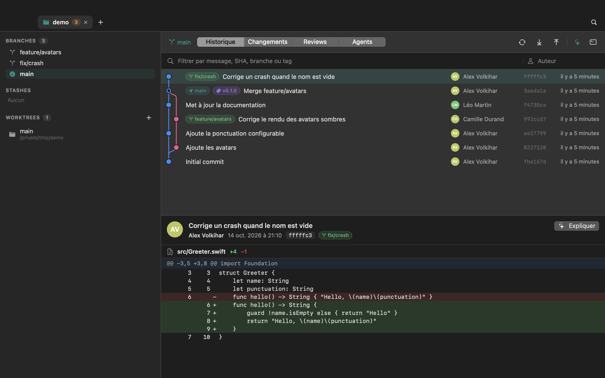
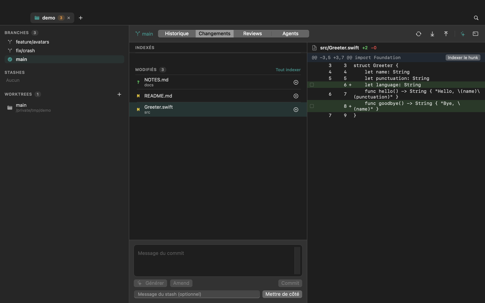

<div align="center">


# Tsuta

[English](README.md) · **Français**

**Un client Git natif pour macOS, rapide et sans compte.**<br/>
Historique en graphe, indexation ligne par ligne, résolution de conflits, rebase interactif,<br/>
reviews GitHub / GitLab et agents de code (Claude Code, Codex) au même endroit.

[](https://github.com/Alexvolkihar/Tsuta/actions/workflows/ci.yml)


[](LICENSE)



</div>

## Pourquoi Tsuta

- **Natif.** SwiftUI + AppKit, un binaire de quelques Mo, aucun Electron.
- **Fidèle à Git.** Tsuta ne réimplémente pas Git : il pilote le binaire `git` de ton Mac. Hooks,
  config, worktrees et sous-modules se comportent exactement comme dans ton terminal.
- **Transparent.** Chaque commande lancée apparaît dans la console Git (`⌘J`).
- **Interface en français** pour l’instant (la traduction n’est pas faite).
- **Sans serveur ni compte.** Aucune télémétrie, aucune clé d’API. Les forges passent par `gh` /
  `glab`, l’IA par les CLI `claude` / `codex` déjà installées et connectées sur ta machine.

## Fonctionnalités

| | |
|---|---|
| **Historique** | Graphe en lanes colorées, pastilles HEAD / branches / tags, avatars, filtre par message, SHA, branche, tag ou auteur, détail du commit. Menu contextuel : cherry-pick, revert, checkout détaché, reset, rebase interactif. |
| **Changements** | Index, working tree, **indexation par hunk ou par ligne**, discard annulable, commit / amend, stash. Le diff se met à jour tout seul quand tu modifies des fichiers ailleurs. |
| **Conflits** | Éditeur par bloc (nôtre / leur / les deux / inversé), support diff3, suggestion de résolution par IA, bannière Continuer / Abandonner pour merge, rebase, cherry-pick et revert. |
| **Rebase interactif** | pick, reword, squash, fixup, drop, réordonnancement par glisser-déposer. Aucun éditeur n’est ouvert. |
| **Reviews** | PR GitHub et MR GitLab : checks, décision, diff avec **commentaires inline**, discussion, commenter, approuver, demander des changements, fusionner. Copie locale pour lire hors ligne. |
| **Agents** | Liste des sessions **Claude Code** et **Codex** menées dans le dépôt et ses worktrees ; reprise en un clic dans Terminal. |
| **IA** | Message de commit depuis le diff indexé, explication d’un commit, résumé d’une review, suggestion de résolution de conflit. |
| **Branches** | Bascule, merge et rebase par **glisser-déposer** d’une branche sur une autre, worktrees, sous-modules, stashes. |
| **Confort** | Onglets multi-dépôts, palette de commandes (`⌘K`), zoom (`⌘+` / `⌘-`), clair / sombre, réglages, undo (`⌥⌘Z`). |

<div align="center">

</div>

## Installation

### Depuis les releases

1. Télécharge `Tsuta-<version>-macos.zip` depuis la page [Releases](https://github.com/Alexvolkihar/Tsuta/releases).
2. Décompresse et glisse `Tsuta.app` dans `/Applications`.
3. L’app n’est pas notarisée : au premier lancement, clic droit → **Ouvrir**, ou :
   ```sh
   xattr -dr com.apple.quarantine /Applications/Tsuta.app
   ```

### Depuis les sources

Swift 6 et macOS 14+ suffisent (les Command Line Tools, sans Xcode, aussi).

```sh
git clone https://github.com/Alexvolkihar/Tsuta.git
cd Tsuta
./scripts/build-app.sh      # → build/Tsuta.app
open build/Tsuta.app
```

`./scripts/package.sh --universal` produit en plus un zip Apple Silicon + Intel.

## Prérequis optionnels

| Fonction | Outil |
|---|---|
| Reviews GitHub | [`gh`](https://cli.github.com), connecté (`gh auth login`) |
| Reviews GitLab | [`glab`](https://gitlab.com/gitlab-org/cli), connecté |
| IA et sessions | [Claude Code](https://claude.ai/code) (`claude`) et / ou Codex (`codex`) |

Sans eux, tout le reste fonctionne.

## Confidentialité et sécurité

- Tsuta n’ouvre **aucune connexion réseau** lui-même ; seuls `git`, `gh`, `glab` et les CLI d’IA le font.
- Quand tu demandes une génération, le diff concerné est envoyé à **l’outil IA que tu as choisi**,
  lancé sur ton Mac avec ton propre compte.
- Claude est lancé **sans outils** (`--tools ""`) et hors du dépôt : une instruction cachée dans un
  diff ne peut ni lire ni modifier tes fichiers, le modèle ne produit que du texte. Les diffs sont
  présentés au modèle comme de la donnée, jamais comme des instructions.
- Les commandes Git sont lancées avec `--no-optional-locks`, sans invite interactive.
- L’app n’est pas sandboxée (elle doit pouvoir lancer `git` et lire tes dépôts).

## Développement

```sh
swift build                  # compile tout
swift run tsuta-selftest     # 114 vérifications sur de vrais dépôts git
./scripts/build-app.sh       # empaquette l'app
```

Les tests sont un exécutable (`tsuta-selftest`) car XCTest et swift-testing ne sont pas fournis avec
les Command Line Tools. Ils créent de vrais dépôts temporaires : merges avec conflit, rebase
interactif, indexation partielle via `git apply --cached`, stash, worktrees.

Tsuta sait prendre ses propres captures, sans autorisation d’enregistrement d’écran :

```sh
Tsuta --open /chemin/du/depot --mode changes --snapshot out.png --size 1280x800
```

L’architecture est décrite dans [docs/ARCHITECTURE.fr.md](docs/ARCHITECTURE.fr.md).

## Feuille de route

- Indexation partielle depuis la vue d’un commit (cherry-pick partiel)
- Blame et historique d’un fichier
- Notarisation et mises à jour automatiques
- Tests d’interface automatisés

Les contributions sont bienvenues : ouvre une issue avant un gros changement.

## Licence

[MIT](LICENSE) © 2026 Alexvolkihar
